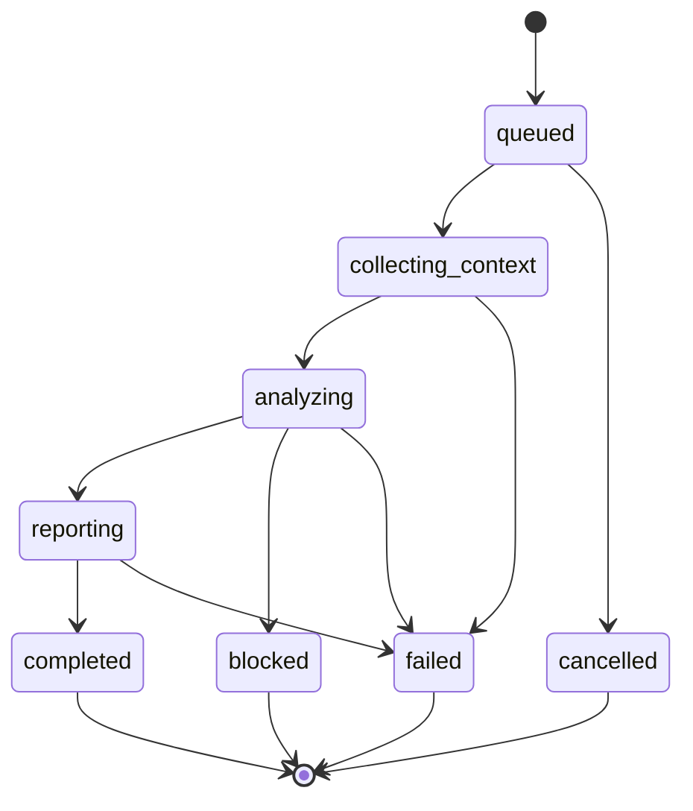

# Iso — Functional and Technical Specification

> **Status:** Draft implementation contract.  
> **Companion documents:** [`idea.md`](idea.md), [`plan.md`](plan.md), [`arch.md`](arch.md), [`prd.md`](prd.md).  
> **Key constraint:** Use Nebius Token Factory for NVIDIA open-source model inference; do not assume Nebius AI Cloud credits for execution.

## 1. Scope

This specification describes the event/run/step contracts, GitHub integration, model output, policies, patch flow, user-authored workflows, runner protocol, security requirements, and acceptance behavior from v0.1 through v2.0. Schema examples are proposed implementation contracts and should be versioned before being persisted or exposed publicly.

## 2. Core terminology

- **Event:** a normalized external or scheduled trigger.
- **Workflow definition:** a versioned graph/list of typed steps, a trigger, and policy reference.
- **Run:** one execution of a workflow version for one trigger event and target revision.
- **Step:** one registered operation with inputs, outputs, status, evidence, and retries.
- **Finding:** a normalized issue or diagnosis linked to evidence.
- **Evidence:** a traceable source such as a GitHub check, log range, commit SHA, scanner result, test outcome, or file/line.
- **Execution adapter:** a provider-specific interface that performs allowed work. GitHub Actions is the early adapter; customer runners arrive in v0.5.
- **Outcome:** the business result of a run, distinct from its lifecycle state.

## 3. Lifecycle and state machine



Later workflow types may include `waiting_for_approval`, `proposing_patch`, `waiting_for_checks`, `verifying`, or `executing`. Keep step status separate from run status so individual versions can extend workflows without redefining the meaning of existing states.

### Run lifecycle states

`queued`, `collecting_context`, `analyzing`, `reporting`, `waiting_for_checks`, `waiting_for_approval`, `proposing_patch`, `verifying`, `completed`, `failed`, `cancelled`, `blocked`.

### Run outcomes

`diagnosis_ready`, `issues_found`, `no_findings`, `fix_proposed`, `fix_verified`, `fix_not_verified`, `inconclusive`, `execution_failed`, `policy_blocked`.

### Step states

`pending`, `running`, `passed`, `failed`, `timed_out`, `skipped`, `cancelled`, `blocked`, `retrying`.

### Finding states

`suspected`, `reproduced`, `fix_proposed`, `fix_verified`, `inconclusive`, `dismissed`.

Only deterministic application code may move a finding to `reproduced` based on approved execution evidence, or to `fix_verified` when required checks pass for the exact candidate commit. A model cannot set these states by assertion.

## 4. GitHub webhook contract

Endpoint: `POST /api/v1/webhooks/github`.

Processing requirements:

1. Read raw body and verify the GitHub webhook signature before parsing it for action.
2. Validate supported event names and required fields.
3. Persist delivery receipt keyed by GitHub delivery ID.
4. Resolve repository and installation to a connected, authorized Iso resource.
5. Create/queue work using a durable outbox/queue pattern.
6. Return promptly after durable acceptance; do not run model inference in the webhook request.
7. Treat duplicate delivery as idempotent success without duplicate runs or GitHub comments.

### v0.1 event

Subscribe to `workflow_run` completed events and process failed runs only for enabled repositories/workflows. Confirm event field shapes and API permissions against current GitHub documentation during implementation.

### Later events

- `pull_request.opened`, `reopened`, and `synchronize` for PR checks/reviews.
- Scheduled events produced by Iso's scheduler.
- Additional integration-provider events through normalized adapters.

Do not let Iso's own check/comment/PR trigger an infinite loop. Add a source marker and explicit trigger filtering.

## 5. GitHub permissions and execution safety

Use minimum GitHub App permissions for each release. The exact permission names and event subscriptions must be validated against current GitHub documentation during implementation.

- v0.1 needs repository/workflow/check/log read capabilities and only the write scope needed for the selected reporting method.
- Prefer checks or comments that do not require repository content write access.
- v0.2 adds narrowly scoped content/PR write permissions only when patch branch and draft PR creation are enabled.
- Use GitHub App installation tokens rather than personal access tokens as the default.
- Never give a runner a long-lived, broad installation credential.
- Never execute untrusted PR code in a privileged `pull_request_target`/`workflow_run` job that exposes secrets or write credentials.
- Do not execute repository-provided commands on the Iso API/web process.

## 6. API surface

All routes require authenticated identity and tenant/resource authorization except the webhook endpoint, which uses signature verification and installation mapping.

| Method | Path | Purpose | Release |
|---|---|---|---|
| GET | `/api/v1/me` | Current identity and tenant | v0.1 |
| GET | `/api/v1/repositories` | List repositories available to the user | v0.1 |
| POST | `/api/v1/repositories/{id}/enable` | Enable a repository/workflow | v0.1 |
| POST | `/api/v1/webhooks/github` | Receive GitHub webhook | v0.1 |
| GET | `/api/v1/runs` | Paginated run list, filters by repo/status | v0.1 |
| GET | `/api/v1/runs/{id}` | Run detail and outcome | v0.1 |
| GET | `/api/v1/runs/{id}/steps` | Step timeline and status | v0.1 |
| GET | `/api/v1/runs/{id}/findings` | Findings and evidence references | v0.1 |
| POST | `/api/v1/runs/{id}/cancel` | Cancel a cancellable run | v0.1 |
| POST | `/api/v1/runs/{id}/replay` | Explicitly replay a run within limits | v0.1+ |
| POST | `/api/v1/findings/{id}/feedback` | Dismiss/correct a finding | v0.1+ |
| PUT | `/api/v1/repositories/{id}/policy` | Update repository policy | v0.2+ |
| POST | `/api/v1/runs/{id}/repair` | Request an authorized patch attempt | v0.2 |
| GET | `/api/v1/workflows` | List workflows and versions | v0.4 |
| POST | `/api/v1/workflows` | Create a workflow definition | v0.4 |
| POST | `/api/v1/workflows/validate` | Validate YAML/schema and policy | v0.4 |
| POST | `/api/v1/runners/register` | Start runner registration | v0.5 |
| GET | `/api/v1/audit-events` | Authorized audit query | v1.0 |

Do not expose model credentials, GitHub private keys, installation tokens, runner registration secrets, or unredacted provider errors in API responses.

## 7. Data model (logical)

Minimum entities:

- `Tenant`: identifier, plan/limits, created timestamp.
- `UserMembership`: user, tenant, role, status.
- `RepositoryConnection`: tenant, provider, provider repository/install IDs, enabled flag, permissions summary, policy reference.
- `WebhookDelivery`: provider delivery ID, signature-valid flag, event kind, receive status, processed timestamp, safe error code.
- `WorkflowDefinition`: workflow ID, version, name, trigger schema, typed steps, policy version, enabled flag, creator.
- `Run`: tenant/repository/workflow version, event ID, commit SHA, lifecycle state, outcome, timestamps, model metadata, resource usage.
- `RunStep`: run ID, stable step key, type/version, attempt number, status, timings, safe error, evidence references.
- `Finding`: run ID, category, severity, state, summary, evidence references, affected path/line, remediation text.
- `Policy`: tenant/repository scope, allowed actions, approval requirements, budgets, retention rules.
- `Approval`: requested action, requester, approver, decision, expiry, and audit timestamps.
- `AuditEvent`: actor, action, target, policy version, result, timestamp, correlation ID.
- `RunnerRegistration` (v0.5+): runner identity, tenant scope, capabilities, heartbeat, revoked flag; never store runner secret in recoverable plaintext.

Every query and mutation must be authorized by tenant and resource scope; opaque IDs alone do not grant access.

## 8. Model gateway contract

### Request behavior

- Use the configured NVIDIA open-source model available through Nebius Token Factory.
- Keep model ID and Token Factory base URL/key in server-side configuration.
- Set bounded request timeout, max input size, max output tokens, and controlled retries.
- Include only redacted logs, relevant error context, limited diff/code context, and references.
- Treat repository files, log output, comments, and commit messages as untrusted content.
- Do not let the model expand its own tool permissions or call arbitrary URLs/tools.

### Proposed response schema: diagnosis

```json
{
  "schemaVersion": "1.0",
  "summary": "Short diagnosis",
  "observedFacts": [
    { "text": "A test process exited with status 1", "evidenceIds": ["ev_123"] }
  ],
  "likelyCauses": [
    { "text": "A configuration value may be missing", "confidence": "medium", "evidenceIds": ["ev_123"] }
  ],
  "recommendedChecks": ["Confirm the required variable is configured in CI"],
  "patchProposal": null,
  "limitations": ["The failure was not reproduced by Iso"]
}
```

This is illustrative. Validate every field with a runtime schema. `confidence` should be a small category (`low`, `medium`, `high`) rather than an uncalibrated numeric probability. Evidence IDs must resolve to stored evidence and cannot be fabricated as authoritative references.

### Patch schema (v0.2+)

A patch proposal should contain either a bounded unified diff or a list of file updates with the expected base SHA. Validate syntax and paths before applying it. Do not accept arbitrary scripts as a patch execution plan.

## 9. Built-in workflow: `ci_failure_investigation`

### Trigger

`workflow_run.completed` with a failed conclusion, for an enabled repository and workflow.

### Steps

1. `validate_event`: verify supported event, repo scope, and idempotency.
2. `collect_run_metadata`: retrieve workflow/job/commit references.
3. `collect_failure_logs`: fetch failed job logs and bound output size.
4. `redact_context`: redact secret-like strings and remove irrelevant output.
5. `collect_code_context`: obtain minimal changed-file/diff context if authorized and useful.
6. `analyze_failure`: call Nebius Token Factory and validate structured diagnosis.
7. `normalize_findings`: map model output to findings and link valid evidence references.
8. `publish_report`: post approved check/comment content using GitHub adapter.
9. `finalize_run`: store outcome, usage metadata, and retention deadlines.

Failure in optional code-context retrieval should not prevent a log-only diagnosis. A model failure should produce an explicit unavailable/inconclusive status and a retryable safe error, not fabricate a diagnosis.

## 10. Repair flow (v0.2)

1. A user or repository policy authorizes a repair attempt.
2. The model receives the narrowest useful context and returns a patch proposal.
3. A deterministic validator checks diff format, target base SHA, path restrictions, file count/size limits, and forbidden paths.
4. Policy determines whether to stop at a proposal or create a branch/draft PR.
5. Iso uses GitHub APIs to create the candidate branch and PR. It does not execute the proposed code on its own application host.
6. The repository's existing CI executes according to repository policy and reports results for the exact candidate SHA.
7. Iso waits for configured checks, then marks the candidate verified only when all required checks pass. Otherwise it reports failed or inconclusive verification.
8. No automatic merging by default. Human review remains required unless an administrator explicitly configures a later, separately reviewed policy.

Reject or require additional approval for changes to `.github/workflows/`, scripts used by privileged CI, dependency lockfiles, build/release configuration, generated files, or other high-risk paths by default.

## 11. User-defined workflow schema (v0.4+)

Illustrative workflow:

```yaml
version: 1
name: repair-failed-build
trigger:
  type: github.workflow_run.completed
  conclusion: failure
steps:
  - id: diagnose
    type: ci_failure_investigation
  - id: propose_patch
    type: propose_patch
    when: finding.state == "suspected"
  - id: request_review
    type: request_approval
    input: proposed_patch
  - id: report
    type: publish_summary
policy:
  create_draft_pr: approval_required
limits:
  max_attempts: 2
  timeout_seconds: 900
```

This is a proposed schema, not a feature claim for v0.1. The v0.4 implementation must define a formal schema, expression grammar, versioning rules, allowed step registry, and execution semantics. Reject unknown step types and unsafe expressions. No arbitrary shell execution in hosted mode by default.

## 12. Runner protocol (v0.5+)

Minimum conceptual operations:

- `register`: exchange a short-lived one-time registration code for a scoped identity.
- `heartbeat`: report runner version, health, and permitted capabilities.
- `lease_job`: request one job matching the runner's scope.
- `start_step`: acknowledge execution of an authorized typed step.
- `upload_result`: submit schema-validated output and evidence references.
- `cancel_job`: stop work cooperatively, then enforce a hard timeout.
- `revoke`: administrator disables the runner identity.

Prefer outbound-only TLS connections. Runner credentials are tenant-scoped, revocable, and not exposed to repository scripts. A runner must not be able to request jobs outside its configured allowlist.

## 13. Security requirements

- Verify webhook signatures and reject invalid signatures.
- Authorize tenant/repository access server-side on all API routes.
- Redact secrets before inference and logs; avoid logging complete prompts by default.
- Treat all repository content and model output as untrusted.
- Validate model outputs, workflow definitions, patches, and runner messages against schemas.
- Apply action allowlists, approval gates, timeouts, quotas, and concurrency limits.
- Do not execute repository code in the control plane.
- Never expose broad write credentials to untrusted code or customer runners.
- Use safe GitHub Actions event/permission patterns; never give untrusted PR code access to privileged secrets.
- Escape logs, diffs, and model text in the dashboard.
- Audit all GitHub writes, approvals, policy changes, and runner registrations.
- Test duplicate events, replay, prompt injection, path traversal, cross-tenant access, unauthorized action attempts, and credential leakage.

## 14. Retention requirements

- Configure independent retention for run metadata, logs/context, model outputs, patches, and artifacts.
- Default to retaining concise summaries and evidence references rather than full raw logs.
- Provide an authorized user mechanism to delete Iso-stored run artifacts where supported.
- Record cleanup status, but distinguish Iso cleanup from GitHub Actions, Nebius Token Factory, storage-provider, backup, and telemetry retention.
- Do not claim that a job's end or a runner's deletion proves that all data is gone from all providers.

## 15. v2.0 workflow capability contract

Non-coding workflow steps must declare:

- Input schema and data sensitivity.
- Output schema and artifact handling.
- Model provider/model ID if inference is used.
- Execution resource profile (CPU, RAM, GPU, disk, timeout).
- Network permissions and allowed external destinations.
- Required tools/capabilities and approval level.
- Data-retention and deletion behavior by provider.

Support only selected workload types until their isolation, quota, and retention behavior is documented and tested.

## 16. Acceptance tests by release

### v0.1

- Invalid GitHub signature rejected.
- Duplicate delivery creates one run.
- Failed workflow produces a diagnosis tied to a workflow ID and commit SHA.
- Evidence IDs resolve to actual references; model cannot invent a successful test status.
- Token Factory timeout/malformed output results in safe failure/inconclusive state.
- No repository code executes in the control-plane process.
- Iso's own comments/checks do not cause a loop.

### v0.2

- Invalid patch and forbidden file path are rejected.
- Candidate branch is created only under authorized policy.
- Required checks are evaluated against the exact candidate SHA.
- Passing checks may mark a fix verified; failing/missing checks cannot.
- No automatic merge occurs by default.

### v0.3–v0.4

- Scheduled events are idempotent.
- Scanner/source versions and evidence are recorded.
- Invalid YAML or unregistered steps are rejected before execution.
- Retry, timeout, cancellation, and approval policy are enforced.

### v0.5–v2.0

- Revoked or out-of-scope runners cannot lease work.
- Runner messages cannot exceed schema/size limits or escalate permissions.
- Retention expiry is tested and provider caveats are visible.
- Non-coding workflows cannot access unrelated tenants' data or undeclared network destinations.
